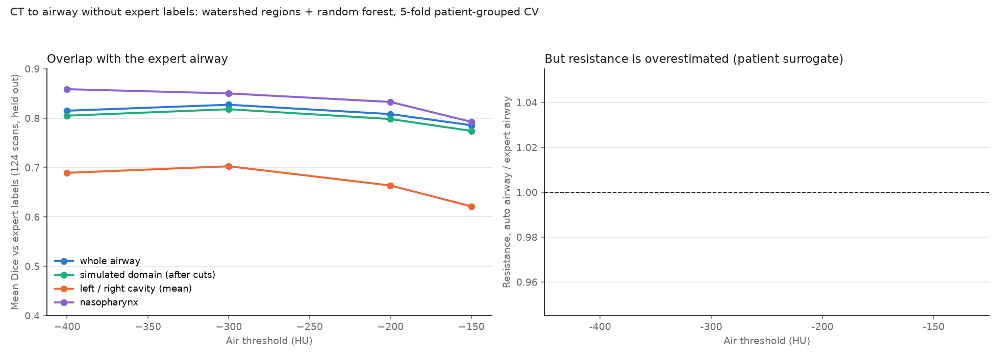
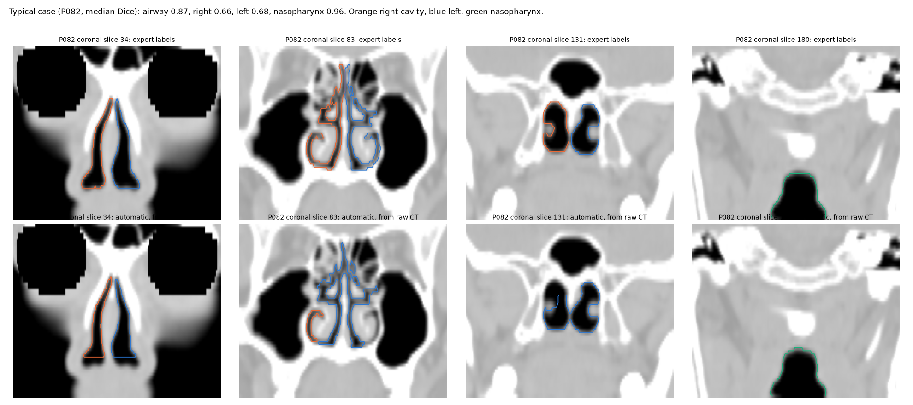
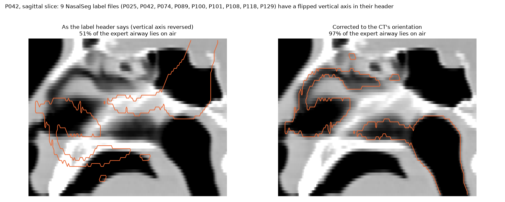

# Nasal0

A prototype for evaluating nasal airway obstruction. It builds airway geometries (parametric tubes, and real patient airways from CT), estimates airflow resistance by region, and wraps the tools in agents that explain the results and plan virtual surgery, on any OpenAI-compatible model API (OpenAI by default). Physics and decision rules are plain code, never a language model, so every number traces back to a formula or a simulation.

## At a glance

Built for the NVIDIA x Red Hat Small Models Hack; see [SUBMISSION.md](SUBMISSION.md) for the pitch and track mapping, and [PRESENTATION.md](PRESENTATION.md) for the demo script.

- **Real anatomy:** 130 NasalSeg CT airways, 126 simulated in OpenFOAM on NVIDIA Brev (median nasal resistance 0.146 Pa·s/cm³ at 150 Pa).
- **Fast surrogate:** under 0.2 ms per prediction, 16.3% mean side error (cross-validated) against 29.9% for "average patient".
- **Surgeon agent:** operates on a patient's CT airway with parametric virtual surgery (side, region, depth), checks each candidate in OpenFOAM, undoes what does not help, and shows every change live in the studio. A spectator mode replays every step, and OpenFOAM's wall pressure, air speed and convergence are drawn while the solver runs.
- **Four agents** on OpenAI's API by default (`gpt-4.1-mini`, `store=False`), or Anthropic, Google Gemini, OpenRouter or any OpenAI-compatible endpoint. Code validates every tool call, and every number the Explainer writes is checked against the tool results. For real patients, every number the agents report comes from OpenFOAM. Their reliability on OpenAI has not been measured yet (`nasal-agents --eval`).
- **Virtual surgery, verified in OpenFOAM:** on 10 obstructed real airways, Workflow++ reached the best plan's drop for 10 of 10, the standard rule for 1 of 10.
- **Data:** every simulated result (125 patients, 96 surgery runs, 106 idealized airways, surrogates) is in [dataset/](dataset/README.md), CC BY 4.0.
- **Apps:** `nasal-studio`, CT to airway, OpenFOAM, virtual surgery and agents in one window; `nasal-demo`, a 3D resistance map of a real patient with what-if sliders and live agent steps.

```bash
pip install -e ".[dev,sim,surrogate,agents,patients,demo]"
pytest
```

## Design

### Agents

All four agents run on one model through an OpenAI-compatible API: OpenAI's `gpt-4.1-mini` by default (set it in the studio's Settings, with `--model`, or with `NASAL_OPENAI_MODEL`), or a provider picked in the studio's Settings (`nasal.providers`: Anthropic, Google Gemini, OpenRouter or a custom address; the provider is detected from the pasted key). The providers do not publish their models' sizes. Requests to OpenAI are sent with `store=False`; what other providers keep is set by their own data policies, and only the patient id, the question and computed numbers are sent, never a CT. Each agent has its own instructions and may call only its own tools.

| Agent | Model | Tools it may call | Job |
| --- | --- | --- | --- |
| Case | OpenAI (`gpt-4.1-mini`) | `set_case`, `set_patient` | Picks a real NasalSeg patient by id, or turns a description into the three case parameters; code validates them and returns errors for the model to fix |
| Planner | OpenAI (`gpt-4.1-mini`) | `predict_resistance`, `formula_resistance`, `what_if`, `patient_resistance`, `recommend_surgery`, `patient_what_if`, `patient_surgery_options`, `finish` | Decides which physics tools answer the request. For a real patient, every tool reads OpenFOAM: the patient's own run, one procedure plan's run, or all 7 plans for surgery questions (stored runs, or new runs with `--live` and in the studio) |
| Critic | OpenAI (`gpt-4.1-mini`) | `review_results`, `check_parameters`, `report_flags` | Runs the code checks and picks which flags to show; it can cite only flag ids the checks produced |
| Explainer | OpenAI (`gpt-4.1-mini`) | none | Writes the plain-language summary; code rejects any number not in the tool results and retries once, then falls back to a template written by code |

| Surgeon (separate, `nasal.surgeon`) | same provider | `airway_status`, `technique_info`, `operate`, `undo`, `simulate`, `finish_surgery` | Operates on a real CT airway with the parametric techniques, runs OpenFOAM on each candidate (at most 6 runs) and keeps the best verified airway; it may not finish before checking at least one operation in OpenFOAM |

The agent count stays at four: more agents mostly add latency and failure points. Surgery questions go through the decision rules in `nasal.decision`: `recommend_surgery` runs the final-stage recommender on a synthetic case, and `patient_surgery_options` applies the same Workflow++ rule, technique reasons and dominant-region check to a real CT airway, using OpenFOAM's result for each plan (`nasal.patient_flow`). The rule thresholds are placeholders until an ENT reviews them.

### Tools (plain code, not language models)

| Tool | Choice | Status |
| --- | --- | --- |
| Geometry generator | Python + trimesh | **Done**: `nasal.geometry` |
| Formula baseline (friction + narrowing loss) | Python | **Done**: `nasal.resistance` |
| Case generation | Python + pandas | **Done**: `nasal.cases`, `nasal-generate` |
| Meshing | gmsh (Python API) | **Done**: `nasal.simulate.mesh_side` |
| Airflow ground truth | OpenFOAM v2606 (`opencfd/openfoam-run:2606` in Docker), simpleFoam | **Done**: `nasal.simulate`, `nasal-simulate` |
| Real patient airways | NasalSeg CT labels, voxel hex mesh written as an OpenFOAM polyMesh | **Done**: `nasal.anatomy`, `nasal-patients` |
| CT to airway (no expert labels) | Threshold + watershed regions + random forest (scikit-image, scikit-learn) | **First version**: `nasal.segment`, `nasal-segment`; see CT to airway |
| Fast stand-in model | PyTorch MLP (tubes), power law on measured geometry (patients) | **Done**: `nasal.surrogate`, `nasal-surrogate` |
| Decision rules (standard and improved) | Plain Python functions | **Prototype**: `nasal.decision` (tubes) and `nasal.decision.patient` (real airways, verified in OpenFOAM); thresholds are placeholders pending ENT review |
| Comparison and logging | pandas + JSON agent log | **Done**: `nasal-agents --log` |
| Demo | Gradio + Plotly | **Done**: `nasal.demo`, `nasal-demo` |
| Local explainer (distilled Qwen) | Qwen2.5-14B teacher in Ollama (Docker), LoRA on Qwen2.5-1.5B (PyTorch, PEFT) | **First version**: `nasal.distill`, `nasal-distill`, `scripts/distill_train.py`; `nasal-explainer` (0.99 GB) in Ollama; see Local explainer |
| Studio (CT to surgery in one app) | Gradio + Plotly, OpenFOAM in Docker | **First version**: `nasal.studio`, `nasal-studio`, with the live OpenFOAM view (`nasal.live`) and spectator mode (`nasal.spectator`); see Studio |
| Language model | OpenAI API (`openai` Python client), key from Settings or `OPENAI_API_KEY` | **Done**: see Agents usage |

## Workflow

1. **Generate cases**: the geometry tool makes a few hundred synthetic patients with known parameters. *(done)* Real airways from 130 NasalSeg CT scans are also built and measured. *(done; see Real patients)*
2. **Simulate**: mesh each shape and run OpenFOAM for resistance by region. This takes the longest, so it starts first. *(done: 106 idealized cases and 126 real patients)*
3. **Train the fast model** on the simulation results, recording its error and speedup. *(done; see Fast surrogate)*
4. **Wire up the agents**: the Case agent sets parameters, the Planner calls the fast model, the formula and what-if tools, the Critic checks the results and the Explainer writes the summary. *(done; the placeholder decision rules are not wired in yet)*
5. **Verify with real simulation**: for a sample of cases, run virtual surgery in OpenFOAM and compare both rules' plans against it. This produces the results table. *(done on 10 real airways; see Step 5)*
6. **Demo**: sliders change the anatomy, the resistance map updates, and agent steps appear live with surrogate error and speed. *(done for real patients; see Demo)*
7. **Doctor's check**: at least one ENT review of the rules.

## Case parameters

<!-- params:start -->
| Parameter | Range | Unit | Meaning |
| --- | --- | --- | --- |
| `valve_angle_deg` | 8 to 20 | deg | Internal nasal valve angle (both sides) |
| `turbinate_scale` | 0.6 to 1.6 | - | Inferior turbinate size; 1.0 is the nominal size |
| `septum_deviation` | -1 to 1 | - | Septum bend; positive narrows the left side, negative the right |
<!-- params:end -->

## Geometry and baseline model

Each nasal side is a tube along the airway with four regions: vestibule, valve, turbinate and choana. Each region has its own cross-sectional area and elliptical aspect ratio. The turbinate region is slit-like, so it has a high aspect ratio.

- **Valve area** is a triangle with apex angle `valve_angle_deg`.
- **Turbinate open area** shrinks as `turbinate_scale` grows.
- **Septum deviation** narrows the valve and turbinate on the side it bends into, and widens them on the other side.

The baseline treats each side's pressure drop as `a*Q + b*Q^2` (Rohrer form):

- **Linear term:** laminar friction in an elliptical duct.
- **Quadratic term:** losses at the nostril entry, at each area change (contraction or sudden expansion), and at the choanal exit.

Each area-change loss counts toward the narrower of the two regions, because that constriction is what causes it. For example, the jet leaving a narrow valve counts against the valve, not the turbinate cavity it expands into. The two sides are in parallel. Resistance is reported in Pa·s/cm³ at the standard 150 Pa rhinomanometry reference pressure.

**The baseline is uncalibrated.** Its absolute values are not expected to match measured noses. It exists to rank cases and to be checked against OpenFOAM (first comparison below). Any calibration will be fitted from simulation, never hand-tuned.

## Airflow ground truth (OpenFOAM)

`nasal.simulate` runs each side as its own domain:

- **Mesh:** gmsh lofts the same elliptical cross-sections as `nasal.geometry` and fills the tube with tetrahedra sized to the local tube width (6 across the narrow axis by default, about 60k to 120k cells per side). Patches are `inlet` (nostril), `outlet` (choana) and `wall`.
- **Solver:** OpenFOAM v2606 `simpleFoam` in the `opencfd/openfoam-run:2606` Docker image. The inlet total pressure ramps from 0 to 150 Pa over the first 300 iterations, and the outlet static pressure is 0. At 150 Pa the valve Reynolds number is around 10⁴, so the default model is k-omega SST with wall functions; `--turbulence laminar` is also available.
- **Region drops:** flux-weighted total pressure on planes at the region boundaries, whose x positions come from `REGION_LENGTH`. Region resistances are losses and sum to the side resistance. The choana value includes the kinetic energy leaving the outlet.
- **Output:** the same column names and units as `nasal.resistance.evaluate`, plus `{side}_cells`, `{side}_iterations`, `{side}_converged`, `{side}_unsteadiness` and `{side}_seconds` (wall-clock time to mesh and solve that side).

Residuals plateau instead of converging, because the valve jet is mildly unsteady. When the solver reaches 3000 iterations without meeting its residual targets (`converged` is false), the flow and plane fields are averaged over the last 300 iterations. `unsteadiness` is the flow's standard deviation over that window divided by its mean. It was at most 2% in the runs below.

### First comparison with the baseline

`nasal-simulate --nominal --extremes` runs the nominal case and the six cases in `cases.csv` (seed 0) with the lowest and highest value of each parameter. It printed these ratios (simulated / formula):

| Case | Valve ° | Turbinate | Septum | Total R sim | Total R formula | Ratio |
| --- | --- | --- | --- | --- | --- | --- |
| nominal | 15.0 | 1.00 | +0.00 | 0.058 | 0.076 | 0.77 |
| case_0026 | 20.0 | 0.78 | +0.38 | 0.052 | 0.062 | 0.84 |
| case_0103 | 19.1 | 0.60 | −0.20 | 0.052 | 0.064 | 0.81 |
| case_0199 | 15.1 | 1.44 | +0.99 | 0.085 | 0.090 | 0.94 |
| case_0230 | 16.5 | 1.60 | +0.64 | 0.103 | 0.092 | 1.12 |
| case_0255 | 13.1 | 0.86 | −1.00 | 0.075 | 0.109 | 0.69 |
| case_0269 | 8.0 | 0.62 | +0.60 | 0.126 | 0.181 | 0.70 |

Resistance is in Pa·s/cm³. What this shows:

- **Ranking:** the formula ranks cases fairly well. The Spearman rank correlation is 0.89 on total resistance and 0.84 across the 14 sides.
- **Scale:** per-side ratios run from 0.65 to 1.28, so one constant factor would not calibrate the formula. It overestimates most sides and underestimates sides where the septum narrows a large turbinate.
- **Regions:** the formula charges the jet leaving the valve to the valve. In the simulation that loss happens downstream, so valve resistance is 0.15 to 0.6 times the formula's. Choana resistance is higher on every side, and turbinate resistance on all but one.

No constants have been fitted yet.

**Mesh sensitivity:** for the nominal left side, refining from 69k to 216k cells (`--cells-across 9`) changed the side resistance by 5% (0.116 to 0.122). The region split moved more: valve resistance fell by a third. Treat region values as approximate. For the narrowest side tested (case_0199 left), k-omega SST and laminar runs agreed within 1%.

**Run-to-run scatter:** gmsh's 3D mesher is not deterministic, so rerunning a case gives a slightly different mesh. Rerunning case_0269's left side (narrow valve, the least steady flow) changed its flow by 11% (407 to 453 cm³/s). Expect several percent of noise in single cases, more on narrow sides.

## Fast surrogate

`nasal.surrogate` is a small PyTorch network: 3 inputs, two hidden layers of 64, and 4 outputs, one log resistance per region. One network serves both sides, because the sides are mirror images; a side's input is how far the septum bends toward it. It was trained on the 90 cases simulated so far: the nominal case, five extremes outside the first 100 and 84 of the first 100 cases in `cases.csv` (seed 0). Every number below is cross-validated (5-fold): each case is predicted by a network that never saw it.

| Mean absolute error vs OpenFOAM | Surrogate | Formula baseline |
| --- | --- | --- |
| Total resistance | 7.8% | 23.1% |
| Side resistance | 9.2% | 23.4% |
| Region resistance | 27.2% | 209% |

- **Speed:** a prediction takes 0.15 ms on a laptop CPU. The median OpenFOAM case took 15 minutes of wall-clock time (both sides, 4 cores each), so the surrogate is about 6 million times faster.
- **Weak spots:** the worst side is off by 74% and region values remain rough (see the mesh notes above). The agents' Critic flags large disagreements between the surrogate and the formula.

## Real patients (NasalSeg)

`nasal.anatomy` builds real airways from [NasalSeg](https://zenodo.org/records/13893419) (130 CT scans with voxel labels, CC BY 4.0, DOI 10.1038/s41597-024-04176-1). These are real anatomy, but their flow is still a model: rigid walls, no mucosa, a single steady breath.

- **Labels:** by position in LPS coordinates, 1 and 2 are the right and left maxillary sinuses, 3 and 4 the right and left nasal cavities, and 5 the nasopharynx. `check_labels` verifies this for each scan. 3 scans (P047 to P049) fail the check; they are kept but marked `labels_ok = False`. Scans stored with a reversed axis are flipped on load.
- **Flipped label headers:** 9 label files (P025, P042, P074, P089, P100, P101, P108, P118, P129) claim a reversed vertical axis, with an origin outside their own scan, while their voxels are stored in the CT's order. Read with that header, only about 40% of the airway label lies on air; in the CT's orientation, over 88% does (see CT to airway). `load_labels` now uses the CT's orientation when the image sits next to the labels (`images/` beside `labels/`, as NasalSeg ships them). The first OpenFOAM runs of these patients used the upside-down airway, with the outlet cut at the wrong end of the nasopharynx. All 8 that had run were re-run in the CT's orientation: total resistance changed by −12% to +5% (P100 −12%, P042 −10%, P089 −7%, P108 −7%, P025 −6%, P129 −4%, P118 −4%, P074 +5%), and each side's resistance stayed within 3 percentage points of its total's change. P101 still fails, for the reason below. The results below use the re-run rows.
- **Domain:** both nasal cavities plus the nasopharynx; the sinuses are left out. Each nostril inlet is a flat cut where that cavity's cross-section first reaches 30% of its median. The outlet is a flat cut where the nasopharynx is wide (half its widest axial section). The narrow lower tail of the label is cut off because it otherwise took most of the pressure drop, and rhinomanometry measures pressure in the nasopharynx.
- **Mesh:** every airway voxel (0.59 × 0.59 × 1.5 mm) becomes one hexahedral cell, written directly as an OpenFOAM polyMesh (median 65k cells). The mesh always passes `checkMesh` with zero non-orthogonality. The cost is stair-stepped walls.
- **Solver:** the same simpleFoam k-omega SST setup as the tubes, with both nostrils at 150 Pa total pressure and the outlet at 0. One run gives the left and right flows. Regions are positions along each cavity (0–20% vestibule, 20–35% valve, 35–85% turbinate, the rest plus the nasopharynx choana), not anatomical landmarks.

**Results:** 126 of 130 scans ran. 3 have a cavity or nasopharynx label that doesn't connect to the rest (P086, P098, P101), and P102 diverged twice. One more (P066) has a region boundary with no net flow and is left out of training, which leaves 125.

- **Resistance:** median total nasal resistance is 0.146 Pa·s/cm³, ranging from 0.078 to 1.28, at a median 1031 cm³/s.
- **Asymmetry:** 29 patients have one side over 1.5 times the other.
- **Steadiness:** flow varied by at most 0.8% over the averaging window.

**Patient surrogate:** each side is described by six measured numbers: volume, length, nostril area, narrowest and mean cross-section, and where the narrowest point is. A PyTorch MLP like the tube surrogate overfit these ~250 sides (27% mean and 1175% worst side error, cross-validated). A power law per region does better: ridge regression of log region resistance on log geometry (`PatientSurrogate`).

| Mean absolute error vs OpenFOAM (5-fold, 125 patients) | Power law | Average patient |
| --- | --- | --- |
| Total resistance | 14.4% | 24.6% |
| Side resistance | 16.3% | 29.9% |
| Region resistance | 35.4% | 41.5% |

It underpredicts the most obstructed sides (about 2.6 Pa·s/cm³ in OpenFOAM, predicted about 0.34). The agents therefore use OpenFOAM results for real patients, not this surrogate; the demo's instant what-if sliders still use it.

## Smooth walls and label repair (in progress)

The voxel airways have stair-stepped walls (the scans are 0.59 x 0.59 mm in-plane but 1.5 mm between slices). `nasal.smooth` builds smooth-walled airways for OpenFOAM:

- **Smooth surface from the labels:** the airway's signed distance is Gaussian-smoothed (0.75 mm), shifted so the airway keeps its voxel volume, and Taubin-smoothed; the nostril and outlet openings stay flat, at the same cuts as the voxel case. The surface is meshed with snappyHexMesh (0.8 mm cells, 0.4 mm at the wall, 0.2 mm at the openings) and region resistances are read from cutting planes at the same region boundaries as `anatomy.read_patient`. P022: 346,300 cells, 17 minutes on 8 cores at 900 iterations (the voxel case: 72,575 cells, about 2.5 minutes).
- **Surface from the CT:** optionally the wall is where the lightly smoothed CT crosses -500 HU (halfway between air and soft tissue), within 2 voxels of the labeled airway and without the sinuses.
- **CT-guided label repair** (`repair_labels`): unlabeled voxels below -300 HU within 2 voxels of the airway join it, with the nearest airway label; sinus labels are never changed.

**What P022 showed.** Total resistance (left choana in brackets), Pa·s/cm³, 900 iterations:

| | Expert labels | CT-repaired labels | CT wall at -500 HU |
| --- | --- | --- | --- |
| Voxel walls | 0.2633 (0.914) | 0.1491 (0.114) | |
| Smooth walls | 0.1302 (0.139) | 0.1059 (0.111) | left cavity not connected |

- The expert label joins P022's left cavity to the nasopharynx through only 21 voxel faces (18.5 mm²; the right side: 122 faces, 107 mm²), while 95% of the 277 unlabeled voxels between them are below -300 HU (median -856 HU). The voxel model's left choana resistance comes from that labeling, not from a narrow choana in the CT at -300 HU.
- At -500 HU the left cavity does not reach the nasopharynx at all, so the opening is a slit at the limit of the CT's resolution: whether it is closed, tight or open depends on where the wall is drawn.
- Over the 125 simulated patients, how much a cavity's label touches the nasopharynx label correlates with its voxel choana resistance (Spearman -0.54 left, -0.59 right); P022 (left), P064 (both sides) and P011 (right) touch over fewer than 50 voxels.
- The repair at -300 HU adds a rim of partly-air voxels around the whole airway (9,201 voxels, 13% more airway for P022), not only the gaps, and smoothing lowers resistance further (stair-stepped walls add friction). Which wall position matches real noses cannot be settled without measured airflow (rhinomanometry) for these patients, so the stored results, the surrogate and the surgery study still use the expert voxel labels.

## CT to airway (no expert labels)

Everything above starts from NasalSeg's expert-drawn labels. `nasal.segment` starts from the raw CT instead, so a new patient's scan can enter the pipeline. Its output is a label volume in the same convention (3 right cavity, 4 left, 5 nasopharynx), so the cuts, meshing and OpenFOAM run on it unchanged. The input has to be a CT volume (a stack of slices); a single 2D image cannot give a 3D airway.

**Method:**
1. **Air:** every voxel below a threshold (default −300 HU). Air outside the head is dropped by keeping, in each axial slice, only air enclosed by tissue.
2. **Regions:** the air is split at its narrow necks (watershed on the distance to the wall), so a sinus joined to the nose through a thin opening becomes a separate region.
3. **Palate:** the hard palate is found as bone with air directly above it, near the midline in the front of the head. Heights are measured from it, because many scans include an open mouth whose air would otherwise distort any height measured from the extent of the air. Air below the palate and in front of its back edge (the mouth) is never airway.
4. **Classifier:** a random forest decides from each region's position, thickness, size and intensity whether it is airway. It is trained on the expert labels.
5. **Assembly:** rejected regions that bridge two large kept pieces (for example a choana between a cavity and the nasopharynx) are added back, and the largest connected airway is kept.
6. **Labels:** walking from the nostrils backwards, the two main air regions of each coronal slice are the left and right cavities. The nasopharynx starts at the first 3 slices in a row where air runs unbroken between the cavities over at least 40% of the airway's height. That search starts halfway back along the airway: in the 127 expert label sets that pass the checks the nasopharynx starts between 52% and 83% of the way back (median 69%). Without such a join it starts where the two separate passages end, or else at 69%. Sides come from the regions, not from a fixed midline, so a deviated septum does not swap them.

**Evaluation:** 5-fold cross-validation grouped by patient (duplicate scans share a fold), on the 123 scans whose expert labels pass the checks (P047 to P049 fail the position check; P086, P098, P101 and P102 have pieces that do not connect). Every score below is on scans the classifier did not train on. Resistance is the patient surrogate's prediction for the cut airway; OpenFOAM on the automatic airways is the next step.

| Air threshold | Airway Dice (worst) | Per-side Dice | Nasopharynx Dice | Resistance, auto / expert (median, IQR) | Within 25% |
| --- | --- | --- | --- | --- | --- |
| −150 HU | 0.81 (0.39) | 0.63 | 0.85 | 1.37 (1.07 to 2.28) | 36% |
| −200 HU | 0.83 (0.35) | 0.66 | 0.89 | 1.40 (1.14 to 1.97) | 31% |
| **−300 HU** | **0.85 (0.59)** | **0.69** | **0.91** | 1.62 (1.25 to 2.37) | 24% |
| −400 HU | 0.81 (0.01) | 0.64 | 0.88 | 2.06 (1.48 to 2.82) | 13% |

- **Shape vs flow:** the threshold that best matches the experts' shape (−300 HU) is not the one that best matches their resistance. The nasal passages are only a few voxels wide, so the experts' labels include half-air edge voxels (their median intensity is about −500 HU). A stricter threshold drops those edges, narrows the passages and raises resistance. Dice alone hides this: 0.85 overlap still means a median 62% higher resistance.
- **What fixed the failures:** the first version had 9 scans below 0.5 Dice. All 9 were the flipped label headers above, not segmentation errors: scored against the corrected labels, and trained on them, none is below 0.5 at −300 HU. The palate reference, the bridging step and the bounded nasopharynx search fixed the remaining cases where a cavity was dropped or the nasopharynx was split.
- **Weakest cases:** P042, P057, P020, P070 and P045 (airway Dice 0.59 to 0.66). Their outline is mostly right, but one side is partly given to the other side or to the nasopharynx.





## Usage

```bash
pip install -e ".[dev]"
nasal-generate -n 300 --seed 0 --out data          # writes data/cases.csv
nasal-generate -n 300 --seed 0 --out data --stl    # also writes one STL per side per case
pytest
```

`data/cases.csv` has one row per case: the parameters, total and per-side resistance and flow, and resistance for each side and region.

Simulation needs Docker (running) and gmsh:

```bash
pip install -e ".[dev,sim]"
nasal-simulate --nominal --extremes             # nominal + min/max of each parameter -> data/simulated.csv
nasal-simulate --first 20 --procs 8             # first 20 cases; cases already in the output are skipped
nasal-simulate --ids case_0003 --cells-across 9 --turbulence laminar
```

`data/simulated.csv` has one row per simulated case with the same columns as `cases.csv`, plus `turbulence` and the solver checks. OpenFOAM case folders and logs go to `data/sim/<case_id>/<side>/`. Each side takes about 3 to 5 minutes on 8 cores. The command ends by printing simulated / formula ratios for every column. Tests that need OpenFOAM are skipped when Docker is not available, and the mesh tests are skipped without gmsh.

To use more cores, run several batches at once with separate `--out` files and train on all of them. Keep the total of `--procs` across batches at or below the number of physical cores. The runs call `mpirun --bind-to none`: by default each container pins its processes to the same first cores, which made parallel batches about ten times slower.

The surrogate needs PyTorch:

```bash
pip install -e ".[dev,surrogate]"
nasal-surrogate --sim data/simulated.csv data/simulated_A.csv data/simulated_B.csv
```

It merges the files by `case_id`, prints the cross-validated error and speedup, and writes `data/surrogate.pt` and `data/surrogate_report.json`. Its tests are skipped without PyTorch.

### Real patients

```bash
pip install -e ".[sim,patients]"
# download NasalSeg.zip from https://zenodo.org/records/13893419 and unzip it to nasalseg/
nasal-patients measure --labels nasalseg/labels                          # geometry of every patient -> data/patients.csv
nasal-patients simulate --labels nasalseg/labels --ids P001 --procs 8    # OpenFOAM -> data/patient_sim.csv
nasal-surrogate --patients --sim data/patient_sim.csv                     # -> data/patient_surrogate.json
```

From raw CT instead of expert labels (`pip install -e ".[segment]"`; NasalSeg ships the CT images next to the labels):

```bash
nasal-segment eval --images nasalseg/images --labels nasalseg/labels --thresholds -150 -200 -300 -400  # grouped CV -> data/segment_eval.csv
nasal-segment train --images nasalseg/images --labels nasalseg/labels                                  # -> data/segment_model.joblib
nasal-segment run --ct new_scan.nrrd --out new_scan_seg.nrrd                                            # one scan -> NasalSeg-style labels
nasal-segment holdout --images nasalseg/images --labels nasalseg/labels --ids P022 P064                # train without them, segment them
nasal-patients simulate --labels data/segment_auto --ids P022 P064 --out data/segment_auto_sim.csv     # OpenFOAM on the automatic airways
```

`simulate` skips patients already in its output, so it can resume, and logs a failed patient and moves on. Each patient takes several minutes on 4 cores (we did not time them individually). We ran 12 batches of `--procs 4` on a 48-core Brev instance, each with its own `--out`, and trained on all the files together. With `data/patient_sim.csv` and `data/patient_surrogate.json` present, `nasal-agents` also accepts requests about a patient by id (for example "patient P022: what if the left narrowest section were 30% wider?").

### Demo

```bash
pip install -e ".[demo]"
nasal-demo --labels nasalseg/labels    # needs data/patient_sim.csv and data/patient_surrogate.json
nasal-demo --labels nasalseg/labels --share    # also prints a public gradio.live link (valid 72 h; keep this machine up)
```

The demo opens at http://127.0.0.1:7860.

- **Patient:** pick any simulated NasalSeg patient (it opens on P022, whose left side has three times the right's resistance).
- **3D airway:** an interactive Plotly view colored by each region's resistance, from that patient's OpenFOAM run or from the surrogate.
- **What-if:** sliders widen or narrow each side's narrowest section and recolor instantly through the surrogate.
- **Table:** OpenFOAM against the surrogate for every region, with the surrogate's error and its measured prediction time.
- **Agents:** "Run agents" sends a question to the four agents and lists each step as it happens: tool calls, errors sent back, the code number check. Then it shows the summary and flags. The agents need `OPENAI_API_KEY` (see Agents); everything else works offline.

### Studio

```bash
nasal-studio --images nasalseg/images --labels nasalseg/labels    # opens at http://127.0.0.1:7861
```

One window, laid out like the [VOCO](https://github.com/h3clinic/VOCO) desktop app: patients on the left, the airway in the middle, commands on the right and the agents as the console below.

- **CT to airway:** pick a NasalSeg CT, or upload a CT volume (.nrrd, HU). The airway comes from the expert labels or from automatic segmentation (needs `data/segment_model.joblib` from `nasal-segment train`).
- **Airflow:** every resistance shown comes from OpenFOAM: the stored run where one exists, otherwise **Run airflow** starts one in Docker. The patient surrogate is not used here, because on some airways it is off by more than 30% (P022: 0.141 against OpenFOAM's 0.263 Pa·s/cm³).
- **Virtual surgery:** tick turbinate reduction, valve repair or septoplasty, see the voxels each one adds, then run OpenFOAM on the plan or on all 7 plans. The table ranks the plans by OpenFOAM's resistance drop and marks the standard rule's pick.
- **Faster local runs:** app runs stop at 900 iterations instead of 3000 and use up to 8 cores each, two cases at a time on a 20-core machine (`--procs`, `--iterations`). In the 13 stored 3000-iteration patient runs, total flow at iteration 600 was already within 0.11% of the final value, and P022 run this way matched its stored run within 0.22% in every region in 237 s.
- **Settings** (top right): paste an API key from OpenAI, Anthropic (Claude), Google Gemini or OpenRouter and press **Use key**; the provider is detected from the key, and a custom OpenAI-compatible address (for example a local Ollama server) can be set instead. It stays in the app's memory for that browser session; tick **Remember on this computer** to keep it in the operating system's credential store (Windows Credential Manager, through `keyring`), never in a file. **Test** checks the key with OpenAI and **Forget** removes it. The panel also sets the OpenAI model, whether earlier questions are sent as context, and OpenFOAM's cores per case, cases at once and iterations (900, or 3000 to match the stored runs), and checks that Docker is running.
- **Live airflow:** while any OpenFOAM run started from the app is going (yours or the surgeon agent's), the Airway tab shows the solver as it works instead of a waiting message. Every 25 iterations the case samples the wall pressure over the whole airway and the air speed on three planes (one sagittal plane through each nasal cavity, one axial plane through both). The 3D view shows them on the airway, and a chart below plots the resistance at each iteration, computed from the nostril flows, together with the solver residuals. The top bar gives the iteration, the flow and the current resistance. These are the steady solver's intermediate states on its way to the result, not a time-accurate breath, and the inlet pressure ramps up over the first 300 iterations. `nasal.live` reads the running case and keeps only the newest sample on disk. Stored and command-line runs do not sample, so their results are unchanged.
- **Surgeon agent** (Commands): type a goal and press **Let the agent operate**. The agent reads where the resistance sits, operates with the parametric techniques below, runs OpenFOAM on its airway, undoes what does not help and finishes with a verified result. The 3D view redraws after every cut (added air in green), shows each of the agent's OpenFOAM checks live and is recolored after every result. The console lists each tool call and ends with the agent's summary, which passes the number check or is replaced by a code summary.
- **Spectator:** the Spectator tab replays every change made to the open airway, by you or by the surgeon agent, step by step. That includes what the agent said, each tool call (rejected ones too), each cut and undo, and each OpenFOAM start and result. Step through it, press **Play**, or leave **Follow live** on to watch an agent while it works. Each step shows the airway at that point, with every voxel added or removed since the original, and its OpenFOAM result if that airway was simulated. A chart shows the resistance at every simulated step. **Save session** writes the timeline to `data/spectator/` (one .npz: the original airway plus only the changed voxels of each step), and **Watch saved** replays a saved session later (`nasal.spectator`).
- **Answers from** (Settings): **OpenAI agents**, or **Local distilled Qwen (no API)**, where code picks the tools from the question and the distilled student writes the answer on this computer (see Local explainer). The local option needs the `nasal-explainer` model in Ollama; nothing is sent off the computer.
- **Agents:** the console sends a question to the four agents, which read the same OpenFOAM results and can start the same runs as the app. They run on OpenAI's API only, with the key from Settings (or `OPENAI_API_KEY`) and the model set there (default `gpt-4.1-mini`, or `NASAL_OPENAI_MODEL`), with `store=False`. Earlier questions are kept as context only in the app's memory for that browser session, and **Clear** forgets them. Only the patient id, the question and computed numbers are sent, never the CT. Under OpenAI's API policy that data is not used for training, but it may be kept up to 30 days for abuse monitoring unless the organization has zero data retention. If OpenAI refuses a request (no credits, a bad key, an unknown model), the console says so in plain words.

### Agents

The agents call OpenAI's API. Set your key (the studio takes it in Settings instead) and run:

```bash
pip install -e ".[agents,surrogate]"
nasal-agents "Narrow valve, maybe 9 degrees, septum bends left. What if the valve were widened to 15 degrees?"
```

It prints the summary and writes every model turn, tool call, tool result and check to `data/agent_log.json`.

For a real patient (`nasal-agents "Patient P022: which surgery?"`), resistance, procedure what-ifs and surgery options come from the stored OpenFOAM runs (`data/patient_sim.csv`, `data/patient_surgery.csv`). Surgery options need all 7 plans, which are stored for the 12 patients in Step 5. `--live --labels nasalseg/labels` runs OpenFOAM in Docker for anything missing (900 iterations, a few minutes per case); without it the tool says the run is missing instead of estimating. `--model` picks another OpenAI model.

`nasal-agents --eval` runs 16 fixed probes (`nasal.agent_eval`), scores them in code and writes `data/agent_eval.json`. The probes include patient ids, what-ifs, an unknown patient, an out-of-range valve angle and plain descriptions. The patient what-if probes ask about procedures ("what if the turbinates were reduced?"). It reports completed runs, correct case choices, invalid tool calls caught by code, what-ifs run when asked, and how often the Explainer passed the number check. It has not been run on OpenAI yet, so no results are reported here.

The predictions for synthetic cases use `data/surrogate.pt` when it exists and the formula otherwise; the Critic flags which one was used. The agent tests use a scripted stand-in for the model and need no server.

### Local explainer (distilled Qwen)

A small model that writes the answers on this computer, without an API: it explains the exact numbers, what they mean in practice, the procedures and how they are generally performed, each procedure's result in the model, consequences and alternatives. Numbers still come from code.

- **Teacher:** Qwen2.5-14B-Instruct (4-bit, `qwen2.5:14b-instruct-q4_K_M`) in Ollama, run in Docker with the GPU:

  ```bash
  docker run -d --gpus all --name nasal-ollama -p 127.0.0.1:11434:11434 -v nasal-ollama:/root/.ollama \
    -v "$PWD/data/distill/student/merged:/models/nasal-explainer:ro" -v "$PWD/scripts:/models/scripts:ro" ollama/ollama:0.12.6
  docker exec nasal-ollama ollama pull qwen2.5:14b-instruct-q4_K_M
  nasal-distill build --per-bundle 3
  ```

- **Data:** 221 fact bundles from the agents' tools: 125 patients' OpenFOAM results, the 12 surgery patients' plan options, and each of their 84 plans before and after. Every bundle also carries comparisons computed by code (median over all simulated patients, this patient's percentile, the harder side and by how much, the highest-resistance region). Each bundle gets all 3 questions of its kind. A teacher answer is kept only if every number in it is in the facts and it quotes the key results (the Explainer's number check), with two retries; 15 patients are held out for testing. `build` resumes where it stopped and writes `data/distill/examples.jsonl`.
- **Procedure knowledge:** the teacher gets a short reference card on turbinate reduction, valve repair and septoplasty (techniques, risks, non-surgical alternatives) written from general textbook knowledge. It has not been reviewed by an ENT, so the procedure descriptions need that review before anyone relies on them.
- **Student:** Qwen2.5-1.5B-Instruct, fine-tuned with LoRA (rank 16, 3 epochs) on the teacher's answers in a separate CUDA environment, then packed as a 4-bit model in Ollama. It runs with a 173-character prompt instead of the teacher's 2,700-character one, because it learned the rules and the procedure knowledge from the answers:

  ```bash
  nasal-distill student-data
  python scripts/keep_awake.py -- python scripts/distill_train.py --data data/distill/student.jsonl --out data/distill/student --max-len 3072
  docker exec nasal-ollama ollama create nasal-explainer -q q4_K_M -f /models/scripts/nasal-explainer.Modelfile
  nasal-distill eval
  ```

  Only the answer's logits are computed for the loss: on a 12 GB GPU the full float32 logits (151k-token vocabulary) ran out of memory. Training needs the GPU to itself, so unload the teacher first (`ollama stop`). `scripts/keep_awake.py` keeps Windows from idle-sleeping until the command it wraps exits, without changing power settings.

- **Local answers:** `nasal.distill.answer_locally` picks the tools from the question in code (the patient's OpenFOAM result; the named procedure's before and after; all plans when the question is about surgery) and asks the student. An answer whose numbers are all right but that leaves out a key result gets those results stated first by code; one with a wrong number is retried once and then replaced by the code template.

**Results.** All 663 questions were asked: 622 answers passed the check (which also requires every procedure of a combined plan to be named) and 41 were dropped after three tries. The student trained on the 555 training answers in 31 minutes on an RTX 5070 Laptop GPU (12 GB); the held-out loss went from 1.046 to 0.358. On the 67 held-out questions (the same 15 patients, never seen in training), each model answering once:

| | Student `nasal-explainer` (Qwen2.5-1.5B, 555 answers) | Previous student (359 answers) | Teacher (Qwen2.5-14B) |
| --- | --- | --- | --- |
| Size (4-bit) | 0.99 GB | 0.99 GB | 9.0 GB |
| Passes the full check | 56 / 67 | 55 / 67 | 31 / 67 |
| No number outside the facts | 65 / 67 | 66 / 67 | 61 / 67 |
| Median time per answer (same GPU) | 2.2 s | 1.9 s | 21.4 s |
| Median length | 171 words | 164 words | 143 words |

The extra 196 training answers lowered the held-out loss (0.358 on these 67 questions; the previous student reached 0.401 on its 43) but did not change the pass rate beyond run-to-run variation: on the previous 43 held-out questions the new student passed 35 (the previous student 37). The students do better than the teacher on the full check because they only learned from answers that passed it; most of their failures are a left-out key result, which the local answer path then states by code. An earlier student, trained on 260 answers before the procedure rule, passed 22 of 26 held-out questions (21 in a repeat), so pass counts vary by a few between runs.

- **Limits:** some answers repeat a list, and 2 of the 67 held-out answers used a number outside the facts (the local answer path would retry, then replace them). The procedure descriptions inherit the unreviewed reference card.

### Surgeon agent

`nasal.surgeon.run_surgeon` lets a language model plan and perform virtual surgery on one patient's CT airway; the studio runs it from **Let the agent operate**. The model only chooses tool calls:

- **Techniques** (`nasal.decision.patient.operate`): `turbinate_reduction` (lateral wall of the turbinate region), `valve_repair` (valve region sideways and vertically), `septoplasty` (septum toward the wider side) and `widen` (a general cut of one region: vestibule, valve, turbinate or choana; lateral, vertical or all directions). Each takes a side (left, right or both) and a depth of 1 to 3 voxel layers (about 0.6 mm each). These sizes are modeling choices, not surgical prescriptions; the operations never cross the septum or the nostril and outlet cuts.
- **Checks:** every candidate is run in OpenFOAM (the studio's settings: 900 iterations by default; at most 6 runs per session). The agent may not finish before checking at least one operation, and its final airway is always simulated. Its summary passes the number check or is replaced by a summary written by code.
- **Technique notes:** `technique_info` returns the same general textbook summary as the distillation card (techniques, risks); no ENT has reviewed it. The agent does not search the literature.
- **First run:** on P022 with the local Qwen2.5-14B (as a custom provider through Ollama) and two OpenFOAM runs, the agent tried a left turbinate reduction (0.2633 to 0.2618 Pa·s/cm³), added a right valve repair (0.2524, 4.2% lower than before surgery) and finished with a summary that passed the number check, in 413 s. It did not target the left choana, which holds most of that side's resistance and which only the general `widen` cut can reach. A second run from the studio's **Let the agent operate**, same model and patient, chose turbinate reduction on both sides (0.2633 to 0.2403 Pa·s/cm³, 8.8% lower; 2 OpenFOAM runs, 509 s), redrawing the airway after each cut and recoloring it after each run. In an earlier run, before the rule that at least one operation must be checked, the same model finished without operating.

### Surgeon-agent campaign (in progress)

Thousands of synthetic problem airways, each solved by the surgeon agent and checked in OpenFOAM (`nasal.mutations`, `nasal.campaign`):

```bash
nasal-campaign generate --n 1000 --seed 0              # data/campaign/cases.jsonl
nasal-campaign run --executor smooth --limit 5 --data nasalseg   # local Docker; --executor ssh --host <name> for a remote machine
nasal-campaign report
```

- **Cases:** a real airway (expert labels; the campaign uses the smooth-wall reconstruction) with one to three pathologies of random side and severity: turbinate hypertrophy, valve collapse, septal deviation, choanal narrowing, each 1 to 3 voxel layers. A mutation never closes a side; its severity is lowered instead. Every case is rebuilt exactly from its seed.
- **Reference:** the oracle plan undoes the generated pathologies with the approved operations (for example turbinate hypertrophy left, 2 layers, is undone by turbinate reduction left, depth 2). Because the voxel septoplasty removes more airway than it adds, an oracle that includes it is also simulated without it, and the better of the two counts. The best known drop is the larger of the oracle's and the agent's own best.
- **Success:** the agent's kept plan reaches 90% of the best known drop (the Workflow++ near-best placeholder). Otherwise it tries again, up to 5 attempts, told what it kept, what is reachable and, from code, which regions still hold the most resistance after its plan and how each changed; a case still unsolved is flagged for review.
- **Learning:** every attempt is kept in `experience.jsonl`; before each case the agent is shown the three most similar solved attempts and the two most similar ones that fell short (by each region's share of resistance and the side ratio), with their plans and results.
- **Executors:** `smooth` (smooth walls on the expert labels, local Docker), `voxel` (the voxel airway, about 7 times faster, for trying the loop out) and `ssh` (the smooth case run on a remote machine with Docker; not yet run against a real machine). Results are appended as cases finish, so a stopped campaign resumes.
- **Status:** the generator, the runner and their tests are done. A pilot of 4 cases (voxel walls, local Qwen2.5-14B, 67 OpenFOAM runs) solved 1, a single left turbinate hypertrophy, on the first attempt (8.9% lower against the oracle's 9.4%). The other 3 stayed unsolved after 5 attempts: best 8.4% against 14.1%, 18.9% against 31.0%, and 51.2% against 68.1%. In the first case the agent never cut deeper than one layer; diagnostic feedback, depth guidance and failed attempts in the library followed, after which it found and deepened a narrowed choana. It still repeated earlier plans and worked on regions that were not the problem, so it is now told every earlier attempt, may not keep a plan it already tried, and its instructions say which operation acts on which region. Those last changes have not been piloted yet.

## Surgical decision rules (Workflow++ prototype)

`nasal.decision` compares the standard visual rule with a map-driven rule, scored by virtual surgery. Thresholds are **placeholders, not clinical values**, and no ENT has reviewed them yet.

- **Virtual surgery** (`surgery.py`): turbinate reduction shrinks `turbinate_scale` by 30%, septoplasty sets `septum_deviation` to 0, and valve repair widens `valve_angle_deg` by 4°. Results are clamped to the parameter ranges.
- **Standard rule**: turbinate reduction, plus septoplasty when `|septum_deviation|` > 0.3.
- **Workflow++ rule**: run every combination of procedures through the resistance evaluator, then pick the smallest plan that reaches 90% of the best total-resistance drop.
- **Reclassification**: `python -m nasal.decision --cases data/cases.csv --out data/decisions.csv` writes one row per case with both plans, whether the plan changed, and the resistance drop for each, then prints a summary by dominant region.

- **Suggested course for one case** (`recommend.py`): `python -m nasal.decision.recommend --valve-angle-deg 9 --turbinate-scale 1.3 --septum-deviation 0.6` prints JSON with the regional map before surgery, the Workflow++ suggestion with a code-written reason for each procedure, the standard plan for comparison, every option ranked by modeled resistance drop, and what is not modeled. It uses the trained surrogate (`data/surrogate.pt`) when present, otherwise the formula. The Planner calls it as `recommend_surgery`.

The evaluator is pluggable (`evaluator=`). It defaults to the uncalibrated formula baseline, so the reclassification rates it prints describe the baseline, not real noses. The surrogate or OpenFOAM can be passed in once they are available. The baseline has no inferior/middle/superior flow split or wall shear yet, so the Workflow++ plan's flow-balance and ENS-risk limits are not implemented.

### Step 5: virtual surgery on real airways, verified in OpenFOAM

`nasal.decision.patient` applies the procedures to a patient's voxel airway. Each procedure adds or moves one voxel layer (about 0.6 mm). These are modeling choices, not surgical prescriptions.

- **Valve repair:** widens both valve regions (20–35% of each cavity's length) sideways and vertically.
- **Turbinate reduction:** pushes both cavities' lateral wall outward in the turbinate region (35–85%).
- **Septoplasty:** removes the wider cavity's medial layer and grows the narrower one toward it.
- **Limits:** growth never touches the other cavity or crosses the nostril or outlet cuts, and the airway is kept as one connected piece.

Both rules are applied per patient:

- **Standard rule:** turbinate reduction, plus septoplasty when one side's mean cross-section is over 1.3 times the other's (a placeholder threshold).
- **Workflow++:** scores all 7 plans with the patient surrogate on the operated airway's measured geometry.

`nasal-patients surgery --labels nasalseg/labels --ids P022 --procs 4` then runs OpenFOAM on the untouched airway and on all 7 plans, and prints how each rule's choice compares.

We ran the 12 most obstructed patients whose labels pass the position check. 2 pairs turned out to be duplicate scans in NasalSeg (P009/P010 and P080/P081 have identical geometry), so the results below cover 10 distinct airways, 8 OpenFOAM runs each:

| Plan chosen by | Mean OpenFOAM resistance drop | Within 90% of the best plan's drop |
| --- | --- | --- |
| Workflow++ (surrogate) | 10.5% | 10 of 10 (the best plan itself in 8) |
| Standard rule | 7.5% | 1 of 10 |
| Best plan per patient (OpenFOAM) | 10.5% | |

- **Best plan:** turbinate reduction with valve repair was best or near-best for every patient (mean drop 10.5%, up to 26.7%). Turbinate reduction alone averaged 8.2% and valve repair alone 1.9%.
- **Septoplasty raised resistance** in this model (mean −8.3% alone). The voxel version removes more airway than it adds, so this is an artifact of the model, not a finding about septoplasty. Workflow++ never chose it; the standard rule chose it for 2 patients.
- **The surrogate ranks plans better than it sizes them:** its predicted drops correlate only 0.51 with OpenFOAM's, with a mean error of 6.2 percentage points (all 12 patients scored with the current surrogate in `dataset/models/`). It still picked the right plan, because the plans' differences were large.
- **Limits:** this is a 10-patient sample of the most obstructed airways, with one-layer changes, steady flow and rigid walls. The rules' thresholds are unreviewed placeholders.

## Keeping docs in sync

Sections between `<!-- name:start -->` / `<!-- name:end -->` markers are generated from the code. After changing the parameters, run:

```bash
python -m nasal.docs
```

The test suite fails if these sections are stale. See [CLAUDE.md](CLAUDE.md) for the full consistency rules.

## License

TBD.
